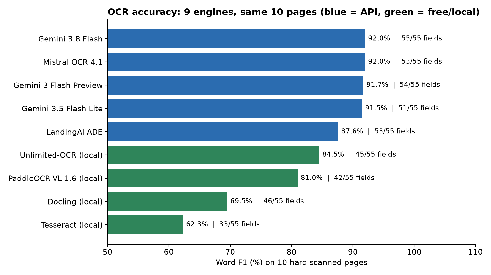

# OCR Benchmark 2026: 9 engines, same 10 scanned pages

Code and results for the article **"Best OCR in 2026: I Benchmarked 9 Engines on the Same Scans (with Code)"**.



| # | Engine | Key fields (55) | Word F1 | s / page | $ / 1,000 pages |
|---|---|---|---|---|---|
| 1 | Gemini 3.8 Flash | **55** | **92.0%** | 4.5 | 3.17 |
| 2 | Mistral OCR 4.1 | 53 | **92.0%** | **0.4** | 4.00 |
| 3 | Gemini 3 Flash Preview | 54 | 91.7% | 3.7 | 2.59 |
| 4 | Gemini 3.5 Flash Lite | 51 | 91.5% | 1.9 | **1.88** |
| 5 | LandingAI ADE | 53 | 87.6% | 2.1 | 30.00 |
| 6 | Unlimited-OCR (Baidu) | 45 | 84.5% | 27 (GPU) | 0 |
| 7 | PaddleOCR-VL 1.6 (Baidu) | 42 | 81.0% | 12.5 (GPU) | 0 |
| 8 | Docling (IBM) | 46 | 69.5% | 6.6 (CPU) | 0 |
| 9 | Tesseract 5 | 33 | 62.3% | 0.7 (CPU) | 0 |

Full comparison, error examples and a "which OCR when" guide: [analysis/ocr_comparison.md](analysis/ocr_comparison.md).

## Folders

```text
data/       ocr_test_10_pages.pdf (the test file), pages/ (same pages as PNG),
            ground_truth/ (text per page), key_fields.json (55 values checked by hand)
code/       one script per engine (PDF -> Markdown), common.py (shared helpers), score.py
output/     the Markdown each engine wrote (first line = run time, cost, version)
diagram/    charts
analysis/   ocr_comparison.md, one <engine>_analysis.md per engine, results.csv, per_page.csv
```

## Run

```bash
python -m venv .venv && source .venv/bin/activate
pip install -r requirements.txt
cp .env.example .env            # add the API keys you need

python code/mistral.py          # writes output/mistral.md
python code/gemini_3_8_flash.py
python code/gemini_3_flash_preview.py
python code/gemini_3_5_flash_lite.py
python code/landingai.py
python code/unlimited_ocr.py    # Apple Silicon (mlx-vlm)
python code/paddleocr_vl.py     # separate environment, see requirements.txt
python code/docling_ocr.py
python code/tesseract_ocr.py

python code/score.py            # writes analysis/results.csv and analysis/per_page.csv
```

API scripts call the engine 3 times (for latency) and save the first answer. A full run of all API engines costs about $1.25 (LandingAI is $0.90 of it).

## How it is scored

- **Word F1:** the output and the ground truth are cleaned (Markdown and HTML removed, lowercase, punctuation stripped) and compared as a bag of words, because the FUNSD ground truth is not in reading order. F1 is computed per page and averaged over the 10 pages.
- **Key fields:** 55 values that matter (IDs, dates, amounts, names, checkboxes, 2 handwritten numbers). A field counts when it appears on its page after removing all whitespace. Three FUNSD values were wrong and are corrected in `key_fields.json`.
- **Speed:** API = time of one 10-page request ÷ 10 (mean of runs 2–3). Self-hosted = warm time per page; it depends on your hardware.
- **Cost:** billed amount (OpenRouter `usage.cost`, LandingAI credits × $0.01) or list price (Mistral, $4 / 1,000 pages).

## Test data

| Pages | Source | Licence |
|---|---|---|
| 1 | Scanned Flipkart retail invoice. The customer's name, address and phone are blacked out. | — |
| 2–3 | [invoice2data](https://github.com/invoice-x/invoice2data) sample invoices (AWS, Free), rasterized | MIT |
| 4–10 | [FUNSD](https://guillaumejaume.github.io/FUNSD/) noisy scanned forms | Non-commercial research and education |

FUNSD: G. Jaume, H. K. Ekenel, J.-P. Thiran. *FUNSD: A Dataset for Form Understanding in Noisy Scanned Documents.* ICDAR-OST 2019.

The outputs and scores in this repo come from the original run. Page 1 had no black box then, so if you run the engines again, page 1 results will be a little different.

## Limits

- 10 pages is a stress test, not a full benchmark. Treat differences under 1 F1 point as a tie.
- Default settings for every engine. Docling and PaddleOCR-VL have options that can raise their scores.
- LLM outputs change between runs, and prices change often (all from 2026-10-17).
